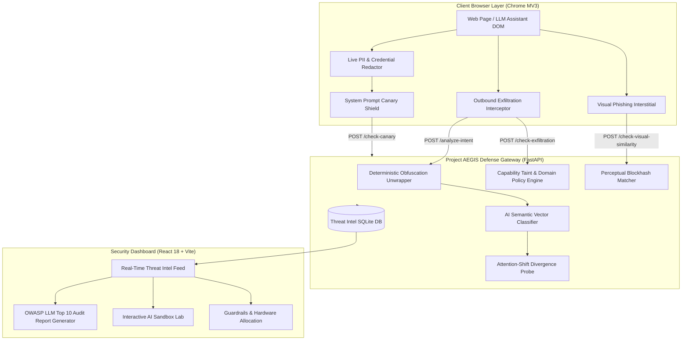

# Project AEGIS: AI Prompt-Injection, Data-Leak & Visual Phishing Firewall

[](https://www.python.org/downloads/)
[](https://fastapi.tiangolo.com)
[](https://react.dev)
[](https://www.typescriptlang.org)
[](https://vitejs.dev)
[](https://developer.chrome.com/docs/extensions/mv3/intro/)
[](https://owasp.org/www-project-top-10-for-large-language-model-applications/)
[](https://github.com/astral-sh/ruff)
[]()

A high-performance, multi-layered security firewall and runtime monitoring gateway designed to protect users of AI assistants (ChatGPT, Claude, Custom LLMs), autonomous web agents, and web applications from **indirect prompt injection**, **outbound credential exfiltration**, **canary token leakage**, and **structural visual phishing clones**.

---

## 1. Executive Summary & Core Capabilities

Project AEGIS implements a local-first, zero-cloud-exposure defense-in-depth architecture covering client DOM events, network transport, AI semantic intent, and executive compliance monitoring:



### Key Defense Features
* **AI Semantic Vector Classifier (`backend/app/ai_engine.py`)**: Prototype-based cosine distance matching against attack families (Direct Override, Roleplay Jailbreak, Delimiter Smuggling `<|im_start|>`, Markdown Image Exfiltration ``) with technical hard-negative suppression to prevent false alarms on code/config snippets (<15ms latency).
* **Attention-Shift Divergence Probe**: Mathematical metric measuring divergence between baseline system instructions and newly introduced input directives.
* **Live PII & Credential Redactor (`extension/src/detectors/piiRedactor.ts`)**: Real-time browser input interception automatically masking OpenAI keys (`sk-...`, `sk-proj-...`), GitHub tokens, AWS credentials, JWT bearer tokens, database connection strings, and financial identifiers before transmission.
* **System Prompt Canary Shield (`extension/src/detectors/canaryShield.ts`)**: Real-time DOM observer tracking assistant responses to identify, block, and sanitize leaked system prompts and canary tokens (`CANARY_TOKEN:...`, `AEGIS-...`).
* **Full-Screen Phishing Interstitial (`extension/src/utils/phishingInterstitial.ts`)**: High-impact, full-screen warning overlay with animated similarity gauge and safety exit triggers when deceptive visual clones are detected via perceptual blockhash Hamming distance matching.
* **Capability Policy & Outbound Exfiltration Interceptor**: Monkey-patches outbound `fetch`, `XMLHttpRequest`, and form submissions to intercept tainted credentials attempting transmission to untrusted domains.
* **Executive Security Audit Report Generator (`dashboard/src/components/AuditReport.tsx`)**: One-click printable PDF-style executive report featuring OWASP LLM Top 10 compliance mapping, incident chronological logs, risk score gauges, and defense architecture overview.
* **One-Click Production Launcher (`start_aegis.py`)**: Automatic port inspection, health-check probing, multi-process management, and browser demo orchestrator.

---

## 2. Monorepo Architecture

```text
├── .github/workflows/ci.yml         # Automated CI testing & validation
├── .env.example                     # Environment configuration template
├── .gitignore                       # Strict isolation for datasets, weights & logs
├── pyproject.toml                   # Python toolchain configuration (Ruff + Pytest)
├── README.md                        # Master project documentation & quickstart
├── AGENTS.md                        # Quality gates, security boundaries & integrity rules
├── start_aegis.py                   # One-click multi-service launcher & supervisor
│
├── backend/                         # FastAPI Gateway, Semantic Engine & Threat Intel
│   ├── app/
│   │   ├── ai_engine.py             # TF-IDF semantic vector classifier & attention probe
│   │   ├── database.py              # SQLite threat storage with SHA-256 payload masking
│   │   ├── main.py                  # REST API endpoints & static demo server
│   │   ├── model_manager.py         # Multi-format obfuscation decoding & hashes
│   │   └── schemas.py               # Pydantic v2 validation models
│   ├── tests/                       # 24 hermetic backend unit tests
│   └── requirements.txt             # Gateway dependencies
│
├── extension/                       # Chrome Extension (Manifest V3 + TypeScript)
│   ├── src/
│   │   ├── background/              # MV3 service worker
│   │   ├── content/                 # Dynamic DOM observer, taint tracker & monkey-patches
│   │   ├── detectors/               # Injections, PII redactor, canary shield, hidden CSS
│   │   ├── popup/                   # Extension popup UI & live status toggle
│   │   └── utils/                   # Phishing interstitial, decoders, blockhash
│   ├── tests/                       # 37 Vitest unit & integration tests
│   ├── manifest.json                # Chrome extension manifest
│   └── package.json                 # Extension toolchain (TypeScript + esbuild + Vitest)
│
├── dashboard/                       # Executive Monitoring Dashboard (React 18 + Vite)
│   ├── src/
│   │   ├── components/              # AuditReport, SandboxInspector, ThreatFeed, Matrices
│   │   ├── hooks/                   # Real-time threat intel streaming hooks
│   │   ├── App.tsx                  # Tabbed executive navigation
│   │   └── main.tsx                 # React application entrypoint
│   └── package.json                 # Dashboard toolchain (React + Tailwind CSS + Vite)
│
├── demo/                            # Interactive Attack Playground & Enterprise SaaS
│   ├── documind/                    # DocuMind AI SaaS app with multi-vector injection demo
│   ├── attack-simulator.html        # 6 standalone synthetic evaluation attack scenarios
│   ├── phishing-google.html         # Structural visual clone simulation page
│   └── README.md                    # Attack scenario walkthrough
│
├── ml/                              # Machine Learning Research & Data Pipelines
│   ├── data/
│   │   ├── pipeline.py              # Config-driven, deterministic compilation pipeline
│   │   ├── sources.py               # Ingestion of BIPIA, deepset, jackhhao & OASST1
│   │   ├── hard_negatives.py        # Disjoint cross-split hard-negative generators
│   │   ├── splitter.py              # Paired group-preserving split partitioner
│   │   ├── cleaner.py               # MinHash & exact deduplication engine
│   │   ├── safety.py                # Zero PII & credential verification scanner
│   │   ├── download_sources.py      # Upstream dataset downloader & integrity verifier
│   │   ├── DATASET_CARD.md          # Formal dataset specification & distribution stats
│   │   └── SOURCES.md               # Upstream licensing & provenance register
│   ├── tests/                       # 11 hermetic dataset pipeline verification tests
│   └── README.md                    # ML research roadmap & architectural plan
│
├── data/raw/
│   ├── MANIFEST.json                # SHA-256 hash manifest of verified raw data
│   └── .gitignore                   # Strict Git exclusion of raw dataset files
│
└── docs/                            # Formal Specifications & Compliance Documentation
    ├── ARCHITECTURE.md              # Architectural specification & data flow
    ├── DATA.md                      # Dataset strategy, schemas & FPR constraints
    ├── EVALUATION.md                # Quantitative evaluation protocol & metrics
    ├── SPEC.md                      # API endpoints & system behavior contracts
    ├── STATUS.md                    # Honest engineering status & component readiness
    └── THREAT_MODEL.md              # STRIDE threat model, actors & attack boundaries
```

---

## 3. Quickstart & Local Execution

### Prerequisites
* **Python**: 3.11+
* **Node.js**: 18+ and npm
* **Browser**: Google Chrome or Chromium-based browser

---

### Option A: One-Click Production Launcher (Recommended)

Run the automated orchestrator from the project root:

```bash
python start_aegis.py
```

The launcher automatically:
1. Validates and acquires backend (port `8000`) and dashboard (port `5173`).
2. Starts the FastAPI Security Gateway with live reloading.
3. Builds and launches the Vite Executive Dashboard.
4. Opens the **DocuMind AI** enterprise SaaS attack demo directly in your default browser.
5. Supervises child processes with crash detection and handles graceful shutdown via `Ctrl+C`.

---

### Option B: Manual Service Startup

#### 1. Backend Defense Gateway
```bash
# Set up Python virtual environment
python -m venv .venv

# Activate environment
# On Windows (PowerShell):
.venv\Scripts\Activate.ps1
# On Linux / macOS:
source .venv/bin/activate

# Install dependencies
pip install -r backend/requirements.txt

# Start the gateway
uvicorn backend.app.main:app --reload --port 8000
```
* **API Documentation**: `http://localhost:8000/docs`
* **Health Check**: `http://localhost:8000/health`
* **Demo Sandbox**: `http://localhost:8000/demo/documind/`

#### 2. Chrome Extension (Manifest V3)
```bash
cd extension
npm install
npm test          # Run Vitest unit & JSDOM tests (37 passing)
npm run build     # Compile content, background, and popup scripts via esbuild
```
**To load into Google Chrome:**
1. Open Chrome and navigate to `chrome://extensions/`.
2. Enable **Developer mode** (top-right toggle).
3. Click **Load unpacked** and select the [`c:/finalYearProject/extension`](file:///c:/finalYearProject/extension) directory.

#### 3. Executive Dashboard
```bash
cd dashboard
npm install
npm run dev       # Starts Vite dev server at http://localhost:5173
```
Visit `http://localhost:5173` to explore the **Overview**, **AI Sandbox Lab**, **Threat Feed**, and **Security Audit Report Generator**.

---

## 4. Testing & Verification Gates

Project AEGIS enforces strict, hermetic quality gates across all modules:

```bash
# 1. Python Code Quality (Ruff)
.\.venv\Scripts\ruff check .

# 2. Hermetic Backend & ML Unit Tests (35 passing)
.\.venv\Scripts\pytest

# 3. Extension Tests (37 passing)
npm --prefix extension test

# 4. Extension Production Build
npm --prefix extension run build

# 5. Dashboard Production Build
npm --prefix dashboard run build
```

---

## 5. Security & Zero Data Exposure Guarantees

* **Zero Raw Data in Logs**: As mandated by [`AGENTS.md`](file:///c:/finalYearProject/AGENTS.md), all user prompt payloads, page fragments, and identifiers stored in `threats.db` are irreversibly hashed with SHA-256 or masked.
* **No Real Secrets Committed**: Authentication tokens, API keys, and environment-specific settings are restricted to `.env` (ignored by Git) and defined via [`.env.example`](file:///c:/finalYearProject/.env.example).
* **Model & Dataset Isolation**: Raw datasets and heavy binary model weights (`*.bin`, `*.pt`, `*.onnx`, `*.safetensors`, `*.pkl`) are strictly excluded from source control via [`.gitignore`](file:///c:/finalYearProject/.gitignore). Upstream datasets are verified strictly against SHA-256 hashes in [`data/raw/MANIFEST.json`](file:///c:/finalYearProject/data/raw/MANIFEST.json).
* **Offline-First Architecture**: All inference, heuristics, perceptual hashes, and sanitization runs entirely locally on CPU / consumer GPU without leaking data to third-party cloud APIs.

---

## 6. License & Scholarly Citation

Distributed under the **MIT License**. See [`LICENSE`](file:///c:/finalYearProject/LICENSE) for details.

```bibtex
@software{project_aegis_2026,
  author = {Kavin Kumar},
  title = {Project AEGIS: AI Prompt-Injection, Data-Leak and Visual Phishing Firewall},
  year = {2026},
  publisher = {GitHub},
  journal = {GitHub repository},
  howpublished = {\url{https://github.com/kavinkumar-77/ai-prompt-injection-firewall}}
}
```
