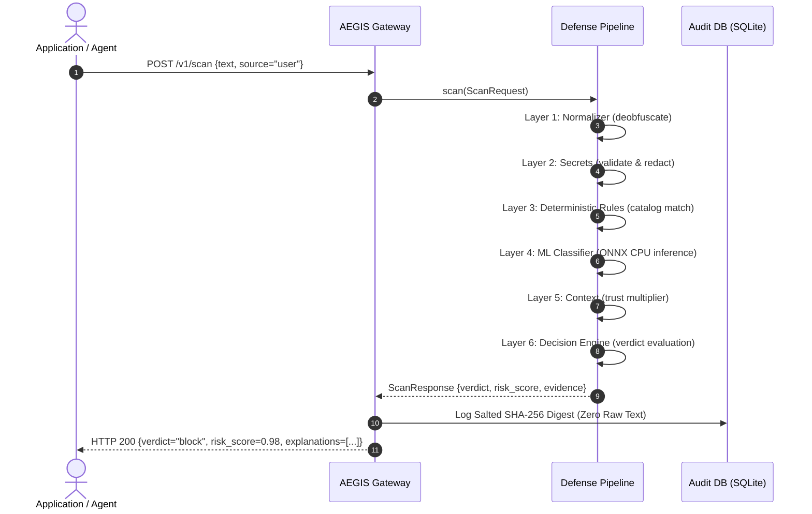
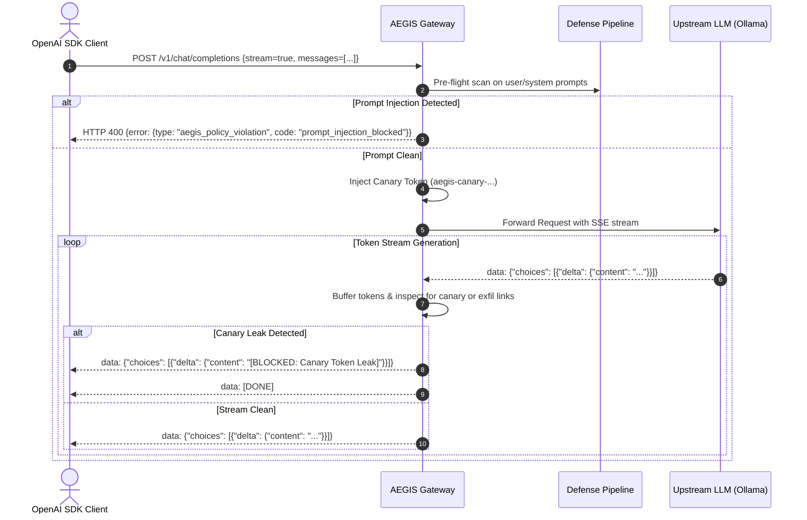
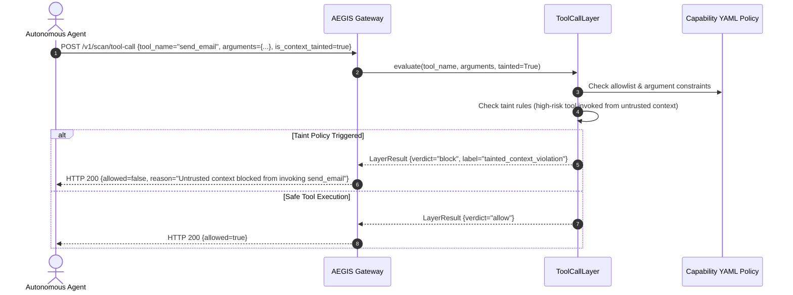

# Architecture Specification: Project AEGIS

## 1. System Overview

**Project AEGIS** is a local-first security gateway and firewall deployed between client applications (autonomous AI agents, web frontends, and OpenAI-compatible SDKs) and Large Language Models (LLMs). It intercepts, normalizes, inspects, and validates prompt payloads and agent actions across a deterministic 6-layer defense pipeline.

```
┌─────────────────────────────────┐
│       Client Applications       │
│  - aegis-client Python SDK      │
│  - OpenAI-compatible clients    │
│  - Browser Agents / Extension   │
└───────────────┬─────────────────┘
                │ HTTP REST / SSE Stream
                ▼
┌────────────────────────────────────────────────────────────────────────┐
│                   AEGIS Security Gateway (FastAPI)                     │
│                                                                        │
│  ┌──────────────────────────────────────────────────────────────────┐  │
│  │                    Sequential Defense Pipeline                   │  │
│  │                                                                  │  │
│  │  1. Normalizer / Deobfuscator                                    │  │
│  │     (NFKC, zero-width stripping, homoglyphs, base64, CSS hidden) │  │
│  │                                                                  │  │
│  │  2. Secrets & PII Engine                                         │  │
│  │     (Entropy analysis, Luhn CC, Verhoeff Aadhaar, API key masks) │  │
│  │                                                                  │  │
│  │  3. Deterministic Security Rules                                 │  │
│  │     (Delimiter smuggling, Markdown exfil, Jailbreak framings)    │  │
│  │                                                                  │  │
│  │  4. ML Classifier Layer                                          │  │
│  │     (Calibrated Logistic Regression on ONNX Runtime CPU)         │  │
│  │                                                                  │  │
│  │  5. Context & Trust Layer                                        │  │
│  │     (Source-aware multipliers: system, user, retrieved, tool)    │  │
│  │                                                                  │  │
│  │  6. Decision Engine & Policy Enforcement                         │  │
│  │     (Active presets: strict, balanced, lenient -> allow/block)   │  │
│  └──────────────────────────────────────────────────────────────────┘  │
│                                                                        │
│  ┌────────────────────────┐  ┌──────────────────────────────────────┐  │
│  │   Canary Token Engine  │  │     Tool-Call Policy Guard           │  │
│  │   (HMAC-SHA-256 Nonce) │  │     (Taint Tracking & Capabilities)  │  │
│  └────────────────────────┘  └──────────────────────────────────────┘  │
└───────────────┬─────────────────────────────────────────┬──────────────┘
                │ Upstream Proxy                          │ Event Log
                ▼                                         ▼
┌─────────────────────────────────┐       ┌──────────────────────────────┐
│       Upstream LLM Provider     │       │   Cryptographic Storage      │
│   (Ollama / vLLM / OpenAI)      │       │   (Salted SHA-256 SQLite/PG) │
└─────────────────────────────────┘       └──────────────────────────────┘
```

---

## 2. Core Components

### 2.1 The Inspection Pipeline (`backend/app/core/pipeline.py`)
Each incoming payload is processed through an ordered, immutable layer chain. Every layer returns a `LayerResult` containing:
- `layer`: Layer identifier (`normalizer`, `secrets`, `rules`, `classifier`, `context`, `decision`).
- `score`: Normalized risk score ($0.0 \le \text{score} \le 1.0$).
- `label`: Classification label (`clean`, `prompt_injection`, `secret_leak`, `pii_detected`).
- `evidence`: List of character `Evidence` spans (`(start, end)`) with forensic descriptions.
- `latency_ms`: Execution time in milliseconds.

### 2.2 Trust Levels (`backend/app/core/trust.py`)
Text payloads carry a trust origin:
- `system`: Highest trust. Instructions define base agent behavior.
- `user`: Standard interactive user input.
- `retrieved`: Untrusted external text (RAG search results, scraped web copy). Carries a $1.35\times$ risk multiplier for instruction-like imperatives.
- `tool_output`: Untrusted execution output (SQL query output, API responses). Carries a $1.45\times$ risk multiplier.

### 2.3 Machine Learning Engine (`backend/app/layers/classifier.py`)
A Sublinear TF-IDF feature extractor + Calibrated Logistic Regression classifier trained on 5,380 curated samples.
- **Export format:** ONNX INT8 quantized (`models/classifier.onnx`, 982 KB).
- **Execution:** Single-threaded CPU execution using ONNX Runtime.
- **Sliding Window:** Analyzes long texts using 500-character windows with a 250-character stride, taking the maximum score across chunks up to a bounded cap of 12 chunks.

---

## 3. Sequence Diagrams

### 3.1 Text Scan Flow (`POST /v1/scan`)



### 3.2 Gateway Streaming Chat Proxy (`POST /v1/chat/completions`)



### 3.3 Agent Tool-Call Capability Guard (`POST /v1/scan/tool-call`)


