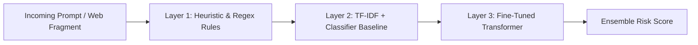

# Machine Learning Research & Experimentation Roadmap

This module is dedicated to research, training pipelines, and offline evaluation for prompt-injection classifiers.

> **Note for AI Assistants**: As specified in `AGENTS.md`, all ML training, fine-tuning, dataset curation, and evaluation code will be authored directly by the project owner. Do not implement automated training routines or synthetic data generation unless explicitly directed.

---

## 1. Planned Progression

The detection stack follows a layered, defense-in-depth architecture:

### Phase 1: Baseline Classifiers (Fast & Interpretable)
- **Heuristic & Signature Matching**: Detection of common jailbreak prefixes, instruction-override idioms (e.g., *"Ignore all previous instructions"*), role-play escapes, and delimiters.
- **Statistical Bag-of-Words / TF-IDF**: Feature extraction using character and word n-grams coupled with a Logistic Regression or linear SVM model for lightweight classification (< 2ms inference latency).

### Phase 2: Transformer Fine-Tuning (Context & Semantics)
- Target backbones:
  - `microsoft/deberta-v3-small` or `deberta-v3-base`
  - `distilroberta-base`
- Objective: Sequence classification binary task:
  - `0`: Benign / Expected text
  - `1`: Injected command / Adversarial instruction
- Latency & Quantization: Export via ONNX Runtime with INT8 quantization for sub-50ms CPU serving.

---

## 2. Benchmark Datasets & Sourcing
- **BIPIA (Benchmark for Indirect Prompt Injection Attacks)**: Evaluating indirect injection vectors embedded in simulated retrieved documents.
- **JailbreakBench / WildJailbreak**: Real-world jailbreak prompts and behavioral safety adversarial queries.
- **Custom Web Corpus**: Extracted DOM fragments containing benign website copy, developer blogs, documentation, and hidden CSS injection test cases.

---

## 3. Evaluation Metrics
- **False Positive Rate (FPR)**: Strict constraint to stay below 1.5% to prevent disruption to normal user browsing.
- **Recall @ Low FPR**: Maximizing detection sensitivity for adversarial injections.
- **Inference Latency**: Target < 50ms per request for local deployment.
